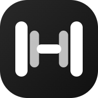
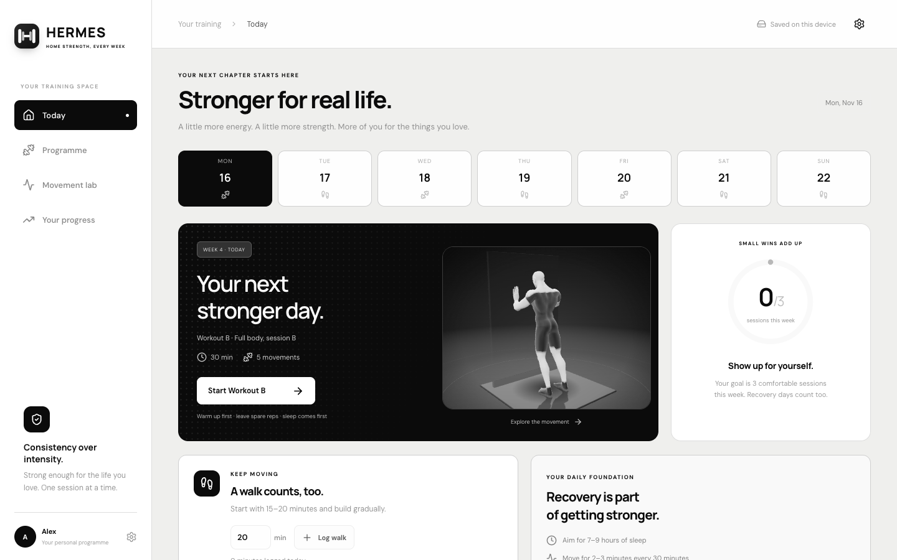
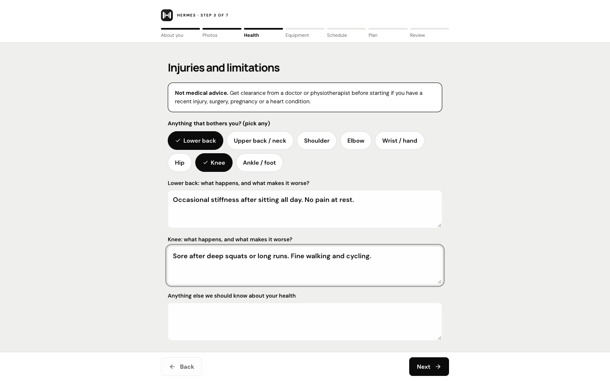
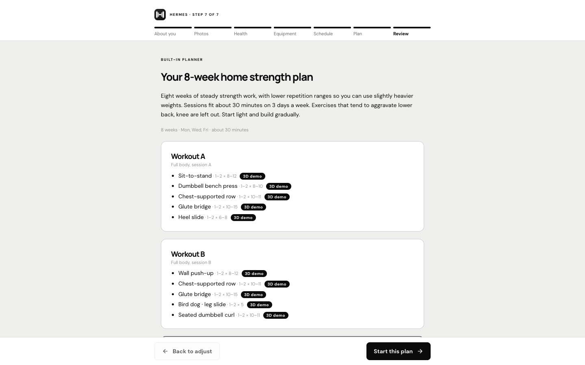
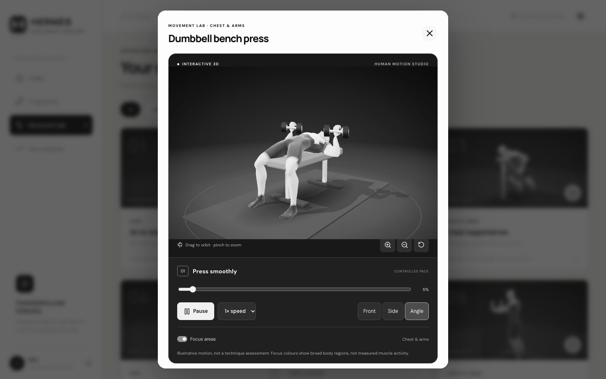
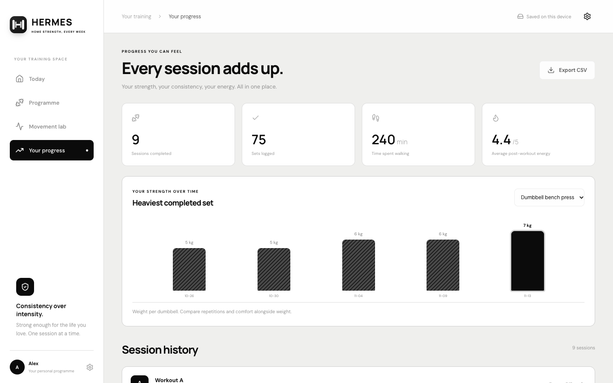

<p align="center">
  
</p>

<h1 align="center">Hermes Workout</h1>

<p align="center">
  A personalised home strength plan, built around your body, injuries and equipment,<br />
  with an interactive 3D movement guide. No account, no server, no tracking.
</p>

<p align="center">
  <a href="https://iamlukethedev.github.io/hermes-workout-app/"><strong>Live demo</strong></a> ·
  <a href="#getting-started">Run locally</a> ·
  <a href="CONTRIBUTING.md">Contribute</a>
</p>

<p align="center">
  
</p>

A short setup asks who you are, any injuries, and what equipment you have (with optional photos). Hermes then builds an eight-week plan, either with **Claude** using your own Anthropic API key, or with the **built-in planner** that works offline. Everything else, including your whole training log, stays in your browser.

<p align="center">
  
  
</p>

## Features

- **Personal setup.** About you, goals, injuries and limitations, available equipment, training days and session length. Optional body and equipment photos give the AI planner more context.
- **AI or built-in planning.** Plan with Claude (bring your own API key) for a programme that can use any exercise, or use the deterministic built-in planner, which works offline and needs no key.
- **Injury-aware.** Plans avoid aggravating movements, add personal safety notes and track a 0–10 check-in for your main concern before, after and the morning following each session.
- **Session logging.** Sets, reps and weight, a rest timer per exercise, session notes, and sets that build gradually across the plan.
- **Progress history.** Per-exercise weight charts, weekly summaries and a walking log.
- **3D movement studio.** A rigged human trainer demonstrates library exercises, with orbit, zoom, camera presets, slow motion, pose scrubbing, left/right views and body-region highlights. Exercises without a 3D model get a step-by-step guide.
- **Works everywhere.** WebGL with a CPU fallback renderer, reduced-motion support, and a mobile layout you can add to your home screen.
- **Your data, portable.** Export a JSON backup or a CSV of every set; import the backup on another device.
- **Try it instantly.** Load a sample log from the Progress tab to explore charts and history without training first.

<p align="center">
  
  
</p>

## Planning with Claude

Choose **Plan with Claude** in the last setup step and paste an API key from the [Anthropic Console](https://console.anthropic.com/settings/keys). A plan typically costs a few cents.

- The request goes **straight from your browser to Anthropic**. Hermes has no server and never sees your key or answers.
- Sent: your setup answers and any photos you added. Photos are resized and stripped of metadata on your device first, and are never saved by the app.
- Your key is kept in this browser only if you tick "remember", and never included in exported backups. You can forget it in Settings.
- Claude may prescribe any exercise. Ones that match the 3D library reuse its demonstrations; others come with written steps.

The model's output is validated against a schema before it's used (`src/lib/ai-planner.ts`). The built-in planner lives in `src/lib/builtin-planner.ts`.

## Getting started

Requires Node.js 20.19+ (22 recommended) and [pnpm](https://pnpm.io).

```sh
pnpm install
pnpm dev
```

Then open the URL Vite prints (usually http://localhost:5173).

### Scripts

| Command          | What it does                         |
| ---------------- | ------------------------------------ |
| `pnpm dev`       | Start the dev server with hot reload |
| `pnpm build`     | Type-check and build to `dist/`      |
| `pnpm preview`   | Serve the production build locally   |
| `pnpm test`      | Run the unit tests (Vitest)          |
| `pnpm lint`      | Lint with ESLint                     |
| `pnpm typecheck` | Type-check without building          |
| `pnpm format`    | Format with Prettier                 |

## Deployment

The build is a static site, so it can be hosted anywhere (GitHub Pages, Netlify, Vercel, Cloudflare Pages, or any static file server). Asset paths are relative, so it also works from a sub-path.

A GitHub Pages workflow is included in `.github/workflows/deploy.yml`. To use it, enable **Settings → Pages → Source: GitHub Actions** in your repository, then push to `main`.

## How data is stored

The whole log, including your setup answers and active plan, is a single JSON document in `localStorage` under the key `hermes-workout:state`. A saved API key lives separately under `hermes-workout:anthropic-key`. It is validated with [Zod](https://zod.dev) when loaded or imported (see `src/lib/storage.ts`). Clearing site data in your browser deletes the log, so export a backup from **Settings → Your data** regularly.

## Project structure

```
src/
  App.tsx                  App shell, state and persistence
  components/              Tabs, modals and the 3D MovementDemo studio
  components/setup/        Setup wizard
  lib/plan.ts              Profile and plan model, schedule and progression rules
  lib/ai-planner.ts        Plan generation with Claude (structured output)
  lib/builtin-planner.ts   Offline rule-based planner
  lib/training.ts          3D exercise library and date helpers
  lib/storage.ts           localStorage persistence and backup validation
  lib/trainer-rig.ts       Skeletal posing with two-bone inverse kinematics
  lib/software-scene.ts    CPU fallback renderer for the same skinned mesh
public/models/trainer.glb  CC0 rigged human model
tests/                     Vitest unit tests
```

`components/MovementDemo.tsx` owns the studio, lighting and playback. `lib/trainer-rig.ts` drives fixed-length bone rotations with two-bone inverse kinematics, and `lib/software-scene.ts` projects the same posed mesh when WebGL is unavailable. See [docs/3D-ASSETS.md](docs/3D-ASSETS.md) for details on the model.

## Disclaimer

Hermes Workout is a general fitness tool, not medical advice, and AI-generated plans can be wrong. The animations are illustrative demonstrations, not motion-captured clinical instruction or an assessment of your technique, and body-region highlights are approximate. Talk to a doctor or physiotherapist before starting a new exercise programme, especially if you have a history of pain or injury, and stop if anything causes sharp, spreading or increasing pain.

## Contributing

Contributions are welcome. See [CONTRIBUTING.md](CONTRIBUTING.md).

## License

Code is released under the [MIT License](LICENSE). The human model is by [Quaternius](https://quaternius.com) and is [CC0 1.0](public/models/QUATERNIUS-LICENSE.txt).
